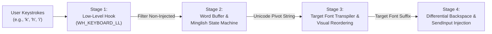

# System Design Specification: Universal Indic Phonetic Transpiler ("Minglish" Engine for Windows)

**Date:** 2026-10-18  
**Status:** Approved Design Specification  
**Target Platform:** Windows 10 / 11 (x64)  
**Implementation Stack:** Modern C++ (C++20), CMake, MinGW-w64 (GCC 16.1 UCRT), Native Win32 APIs  

---

## 1. Intent & The Why

Typists, DTP operators, graphic designers (using CorelDRAW, Adobe PageMaker, Photoshop, InDesign), and everyday Marathi/Hindi users on Windows are trapped in an awkward dilemma:
1. **Legacy DTP Tools (e.g., C-DAC ISM V6):** Clunky, proprietary, expensive, heavily bloated with invasive floating keyboards, dependent on proprietary font locks, and prone to breaking on modern Windows builds.
2. **Modern IMEs (e.g., Gboard / Windows Indic IME):** Strictly Unicode-only, rely on heavy ML/dictionary prediction with intrusive floating suggestion popups, and completely fail when legacy printing presses or publishing houses require non-Unicode legacy fonts (Kruti Dev 010, Shree Lipi, Shivaji, DVB-TTSurekh).

The **Universal Indic Phonetic Transpiler ("Minglish" Engine)** solves this by providing a lightweight, high-performance, background desktop utility that lets users type in Marathi and Hindi across **any** Windows application using one single, natural, deterministic phonetic English keymap ("Minglish"). The engine transpiles user input in real time to either standard Unicode or legacy ASCII/ANSI font encodings without any dictionary popups or ML unpredictability.

---

## 2. Goals, Non-Goals & Anti-Goals

### 2.1 Goals
- **Global Keystroke Interception:** Intercept typing seamlessly across any active Windows application using `SetWindowsHookExW(WH_KEYBOARD_LL)`.
- **Deterministic 3-Stage Pipeline:**
  1. Word buffer & Minglish-to-Unicode deterministic phonetic state machine.
  2. Unicode-to-Target-Font visual reordering & glyph translation.
  3. Differential backspace-and-rewrite injection via `SendInput`.
- **Font-Agnostic Profile System:** Extensible JSON font profiles that describe glyph substitutions, visual reordering rules, and contextual ligatures without requiring engine recompilation.
- **Ultra-Minimal UI (Anti-Bloat):**
  - Subtle system tray icon with context menu.
  - Borderless, click-through, non-focus-stealing corner status pill overlay (`WS_EX_TOPMOST | WS_EX_TRANSPARENT | WS_EX_NOACTIVATE | WS_EX_TOOLWINDOW`).
  - Global hotkeys for ON/OFF toggle (`Ctrl+Space` / `Alt+~`), quick font switcher modal (`Ctrl+Shift+F`), and keymap cheat sheet (`F12`).
- **Zero-Dependency & Sub-Millisecond Latency:** Compiled to a standalone native binary (< 3MB) with zero GC pauses, ensuring Windows low-level keyboard hooks never timeout (`LowLevelHooksTimeout`).

### 2.2 Non-Goals
- Cloud sync or telemetry.
- Machine learning or predictive dictionary completion (no guessing what word the user wants; strictly deterministic).
- Virtual on-screen touch keyboard.

### 2.3 Anti-Goals (Explicitly Avoided)
- **No Caret Coordinate Tracking:** Absolutely do **NOT** use `GetGUIThreadInfo` or UIAutomation to anchor floating windows to the text cursor. This is notoriously brittle and causes crashes/glitches across CorelDRAW, PageMaker, Adobe Suite, and web browsers.
- **No Candidate Popups:** No popup windows obscuring the document workspace.
- **No Proprietary Font Locks:** Clean open configuration format for any legacy font.

---

## 3. Technology Stack & Project Structure

### 3.1 Technology Choices
- **Language:** C++20 (clean abstractions, `std::string_view`, `std::u16string`, standard containers).
- **Build System:** CMake (>= 3.20) with MinGW-w64 (GCC 16.1 UCRT).
- **OS Subsystem:** Windows Win32 API (`user32.lib`, `gdi32.lib`, `shell32.lib`).
- **JSON Configuration:** Header-only lightweight JSON parser (single-header `nlohmann/json` or compact JSON loader).
- **Testing Framework:** Native C++ test runner integrated with `ctest`.

### 3.2 Directory Layout
```
Modern ISM/
├── CMakeLists.txt
├── config/
│   └── fonts/
│       ├── unicode_devanagari.json
│       ├── kruti_dev_010.json
│       └── shree_dev_0714.json
├── include/
│   ├── engine/
│   │   ├── minglish_keymap.hpp
│   │   ├── word_buffer.hpp
│   │   ├── font_profile.hpp
│   │   ├── visual_reorderer.hpp
│   │   ├── differential_injector.hpp
│   │   └── transpiler_engine.hpp
│   ├── hook/
│   │   └── keyboard_hook.hpp
│   └── ui/
│       ├── tray_icon.hpp
│       ├── status_pill.hpp
│       └── font_switcher_dialog.hpp
├── src/
│   ├── main.cpp
│   ├── engine/
│   │   ├── minglish_keymap.cpp
│   │   ├── word_buffer.cpp
│   │   ├── font_profile.cpp
│   │   ├── visual_reorderer.cpp
│   │   ├── differential_injector.cpp
│   │   └── transpiler_engine.cpp
│   ├── hook/
│   │   └── keyboard_hook.cpp
│   └── ui/
│       ├── tray_icon.cpp
│       ├── status_pill.cpp
│       └── font_switcher_dialog.cpp
├── tests/
│   ├── CMakeLists.txt
│   ├── test_main.cpp
│   ├── test_minglish_keymap.cpp
│   ├── test_word_buffer.cpp
│   ├── test_visual_reorderer.cpp
│   └── test_differential_injector.cpp
└── docs/
    └── superpowers/
        └── specs/
            └── 2026-10-18-indic-phonetic-transpiler-design.md
```

---

## 4. The 3-Stage Pipeline Architecture



### Stage 1: OS Keystroke Interception & Hook Management
- Hook installed using `SetWindowsHookExW(WH_KEYBOARD_LL, LowLevelKeyboardProc, hInstance, 0)`.
- **Synthetic Loop Prevention:** Check `(pKeyboard->flags & LLKHF_INJECTED)`. If injected by our own process, immediately return `CallNextHookEx(...)`.
- **Bypass Mode:** When Engine is toggled `OFF`, all keystrokes pass directly to `CallNextHookEx`.
- **Modifier Chord Passthrough:** Any shortcut chord (`Ctrl+C`, `Ctrl+V`, `Ctrl+Z`, `Ctrl+A`, `Alt+Tab`, Windows key shortcuts) triggers an immediate buffer commit/clear and passes through to the OS untouched.
- **Word Boundary Detection:** Word-ending keys (`VK_SPACE`, `VK_RETURN`, `VK_TAB`, `VK_ESCAPE`, navigation arrows `VK_LEFT`, `VK_RIGHT`, `VK_UP`, `VK_DOWN`, mouse clicks, or window focus change) commit the active word:
  - Reset `PreviouslyInjectedString` to empty.
  - Reset the internal word buffer.
  - Pass the boundary key through cleanly to the active application.
- **User Backspace (`VK_BACK`) Handling:**
  - If the word buffer is **non-empty**: Intercept the `VK_BACK` event. Pop the most recent raw keystroke from the buffer history, recompute the transpiled target string, compute the diff against `PreviouslyInjectedString`, and emit the necessary differential backspaces/characters.
  - If the word buffer is **empty**: Pass `VK_BACK` through to the OS so the application can backspace across previous committed words.

### Stage 2: Word Buffer & Minglish-to-Unicode State Machine
Maintains the raw phonetic input for the active word being typed.
- As the user types characters, the state machine tokenizes the input into Indic linguistic units:
  - **Consonant:** Greedy multi-key lookup (e.g. `k` -> `क`, then typing `h` upgrades to `ख`).
  - **Inherent Vowel & Confirmation:** Typing consonant `k` produces `क`. Typing `a` confirms `क`. Typing a second `a` (or typing `A` / `aa`) produces `का`.
  - **Vowel / Matra:** Attaches as a dependent vowel sign (Matra) to preceding consonant (e.g. `k` + `i` -> `कि`). At the start of a word or after an explicit separator, produces independent vowel (e.g. `i` -> `इ`).
  - **Conjuncts & Halant:** Consecutive consonants automatically insert Virama `्` to form a Jodakshar (e.g. `s` + `t` -> `स्त`, `k` + `y` -> `क्य`). Explicit halant key (`/` or `~`) forces a pure half-letter without automatic conjunct clustering.
  - **Anusvara:** Explicit capital `M` produces Anusvara `ं` (`kam` -> `कम`, `kaM` -> `कं`, `saMvad` -> `संवाद`).
  - **Visarga:** `H` / `ah` produces Visarga `ः` (`namah` / `namaH` -> `नमः`).
  - **Chandra Vowels (Marathi / Hindi Loans):** `E` / `c` produces `ॅ` (`bEk` / `bank` -> `बँक`/`बॅक`), and `O` produces `ॉ` (`dOktar` -> `डॉक्टर`).
  - **Marathi ज्ञ vs. ग्य:** `dny` / `jny` produces `ज्ञ` (`dnyan` -> `ज्ञान`). `gy` produces `ग्य` (`bhagya` -> `भाग्य`, `yogya` -> `योग्य`).
- Output of Stage 2 is always valid, canonical **Unicode Devanagari (UTF-16)**.

### Stage 3: Unicode-to-Target-Font Visual Reordering & Transpiler
Translates logical Unicode Devanagari into the target font's physical glyph representation by segmenting the word into orthographic akshara clusters.

#### The 4 Core Linguistic Reordering Rules:
1. **Chhoti Ee (`ि`, U+093F) Pre-Base Reordering:**
   - Unicode stores `क` + `ि` (`कि`).
   - Legacy ASCII fonts (Kruti Dev, Shree Lipi, Shivaji) require the `ि` glyph to physically precede the consonant cluster in the byte stream:
     - `कि` (`क` + `ि`) -> `f` + `d` (where `f` is `ि` and `d` is `क` in Kruti Dev).
     - *Jodakshar* with Chhoti Ee: `स्मि` (`स` + `्` + `म` + `ि`) -> `f` + `L` + `e` (the `ि` glyph precedes the entire half-consonant cluster `स्म`).
2. **The Flying "R" (*Reph* / रफ़ार) Post-Positioning:**
   - In Unicode and phonetics: `र` + `्` + `म` = `कर्म` (typed `k-a-r-m`).
   - In legacy ASCII fonts, the *Reph* glyph (`Z` in Kruti Dev) must be placed **after** the base consonant and after any trailing post-base or above-base matras:
     - `कर्म` -> `d` + `e` + `Z` (`क` + `म` + `Reph`).
     - `कर्मी` -> `d` + `e` + `h` + `Z` (`क` + `म` + `ी` + `Reph`).
3. **Consonant Clusters (*Rakar* / तिरछी रेखा):**
   - Consonant + `्` + `र` (e.g., `प्र`, `क्र`, `त्र`, `द्र`).
   - Mapped to dedicated composite glyphs or the rakar combining mark placed after the consonant.
4. **Special Ligatures & Half-Letters:**
   - Half-consonants (e.g. `क्`, `स्`, `त्`) mapped to specific half-glyph ASCII codes in legacy fonts.
   - Special conjuncts like `क्ष` (`ksh` / `x`), `त्र` (`tr`), `ज्ञ` (`dny` / `jny`), `श्र` (`shr`).

### Stage 4: Differential Backspace & Keystroke Injector
To update what is on screen without full-buffer flicker:
1. Let $T$ be the new target string to display for the active word.
2. Let $P$ be the previously injected target string for the active word.
3. Find length $L$ of the Longest Common Prefix between $P$ and $T$:
   $$L = \max \{ k \mid P[0..k-1] == T[0..k-1] \}$$
4. Number of backspaces to send:
   $$N_{\text{back}} = |P| - L$$
5. New suffix string to append:
   $$S_{\text{new}} = T[L..|T|-1]$$
6. Send $N_{\text{back}}$ instances of `VK_BACK` via `SendInput`.
7. Send $S_{\text{new}}$ characters via `SendInput` using `KEYEVENTF_UNICODE`.
8. Update $P = T$.

---

## 5. Minglish Keymap Specification

### 5.1 Vowels (Swar)
| Key(s) | Independent Vowel | Dependent Matra (after Consonant) |
|---|---|---|
| `a` | अ (word start) | Inherent (confirms consonant, no matra) |
| `aa` / `A` | आ | ा |
| `i` | इ | ि (Chhoti Ee) |
| `ee` / `I` | ई | ी (Badi Ee) |
| `u` | उ | ु (Chhota Oo) |
| `oo` / `U` | ऊ | ू (Bada Oo) |
| `e` | ए | े |
| `ai` | ऐ | ै |
| `o` | ओ | ो |
| `au` / `ou` | औ | ौ |
| `M` | अं | ं (Anusvara) |
| `H` / `ah` | अः | ः (Visarga) |
| `ru` / `Ru` | ऋ | ृ (Vocalic R) |
| `E` / `c` | ॲ | ॅ (Chandra A) |
| `O` | ऑ | ॉ (Chandra O) |

### 5.2 Consonants (Vyanjan)
| Key(s) | Character | Key(s) | Character |
|---|---|---|---|
| `k` | क | `kh` | ख |
| `g` | ग | `gh` | घ |
| `ng` | ङ | | |
| `ch` | च | `chh` / `Ch` | छ |
| `j` | ज | `jh` / `z` | झ |
| `nj` / `ny` | ञ | | |
| `T` | ट | `Th` | ठ |
| `D` | ड | `Dh` | ढ |
| `N` | ण | | |
| `t` | त | `th` | थ |
| `d` | द | `dh` | ध |
| `n` | न | | |
| `p` | प | `ph` / `f` | फ |
| `b` | ब | `bh` | भ |
| `m` | म | | |
| `y` | य | `r` | र |
| `l` | ल | `v` / `w` | व |
| `sh` | श | `shh` / `S` | ष |
| `s` | स | `h` | ह |
| `L` / `ld` | ळ (Marathi L) | | |
| `ksh` / `x` | क्ष | `dny` / `jny` | ज्ञ |
| `tr` | त्र | `shr` | श्र |

### 5.3 Halant, Jodakshar & Reph Rules
1. **Implicit Halant / Conjunct:**
   - Typing two consonants consecutively without a vowel automatically binds them with a Virama:
     - `k` (`क`) + `y` (`य`) -> `क्य`
     - `s` (`स`) + `t` (`त`) -> `स्त`
     - `s` + `m` + `i` -> `स्मि`
2. **Explicit Halant:**
   - Typing `/` or `~` forces an explicit Virama `्` without forming a ligature.
3. **Reph (रफ़ार):**
   - `r` followed immediately by a consonant:
     - `karm` -> `कर्म`
     - `garv` -> `गर्व`
     - `sarva` -> `सर्व`
4. **Rakar (प्र, क्र, त्र, द्र):**
   - Consonant followed immediately by `r`:
     - `pr` -> `प्र`
     - `kr` -> `क्र`
     - `tr` -> `त्र`
     - `dr` -> `द्र`

---

## 6. Font Profile Schema (JSON)

Legacy fonts are supported entirely via configuration files in `config/fonts/`. No C++ code changes are needed to add a new legacy font.

```json
{
  "profile_id": "kruti_dev_010",
  "name": "Kruti Dev 010",
  "encoding": "ascii_ansi",
  "features": {
    "chhoti_ee_pre_base": true,
    "reph_post_base": true,
    "has_half_consonants": true
  },
  "glyphs": {
    "chhoti_ee": "f",
    "reph": "Z",
    "virama": "्",
    "rakar": "z"
  },
  "direct_map": {
    "क": "d",
    "ख": "[k",
    "ग": "x",
    "घ": "?k",
    "च": "p",
    "छ": "N",
    "ज": "t",
    "झ": "T",
    "ट": "V",
    "ठ": "B",
    "ड": "M",
    "ढ": "<",
    "ण": ".k",
    "त": "r",
    "थ": "Fk",
    "द": "n",
    "ध": "/k",
    "न": "u",
    "प": "i",
    "फ": "Q",
    "ब": "c",
    "भ": "Hk",
    "म": "e",
    "य": ";",
    "र": "j",
    "ल": "y",
    "व": "o",
    "श": "'k",
    "ष": "\"k",
    "स": "l",
    "ह": "g",
    "ा": "k",
    "ी": "h",
    "ु": "q",
    "ू": "w",
    "े": "s",
    "ै": "S",
    "ो": "ks",
    "ौ": "kS",
    "ं": "a",
    "ः": "%"
  },
  "half_consonants": {
    "क्": "D",
    "ग्": "X",
    "च्": "P",
    "ज्": "T",
    "त्": "R",
    "थ्": "F",
    "ध्": "/",
    "न्": "U",
    "प्": "I",
    "ब्": "C",
    "भ्": "H",
    "म्": "E",
    "ल्": "Y",
    "व्": "O",
    "श्": "'",
    "ष्": "\"",
    "स्": "L"
  },
  "ligatures": {
    "क्ष": "{"
  },
  "contextual_rules": []
}
```

---

## 7. Minimal UI & Overlay Specifications

1. **System Tray:**
   - Standard Win32 `Shell_NotifyIconW`.
   - Right-click menu:
     - Toggle Minglish (Checked when Active)
     - Target Font -> [Radio list: Unicode Devanagari, Kruti Dev 010, Shree Dev 0714, ...]
     - Cheat Sheet (`F12`)
     - Exit
2. **Fixed Corner Status Pill:**
   - Pinned at bottom-right of primary screen (e.g. `X = ScreenWidth - 190`, `Y = ScreenHeight - 75`).
   - Window Styles: `WS_POPUP`, extended styles `WS_EX_TOPMOST | WS_EX_TRANSPARENT | WS_EX_NOACTIVATE | WS_EX_TOOLWINDOW`.
   - Renders a clean modern dark pill with active status (`● Minglish [Kruti Dev]`).
   - Clicks pass through to whatever application is beneath it.
3. **Hotkeys:**
   - `Ctrl + Space` (or `Alt + ~`): Global Toggle ON/OFF.
   - `Ctrl + Shift + F`: Quick Font Switcher (centered modal with fuzzy list, returns focus instantly upon selection).
   - `F12`: Interactive Cheat Sheet window.

---

## 8. Unit Testing & Verification Strategy

To guarantee zero regression in the transpilation and diffing logic, the test suite (`tests/`) will automatically test:
1. **Multi-Key Phonetic Upgrading:**
   - `k` -> `क`
   - `k` + `h` -> `ख`
   - `c` + `h` -> `च`, followed by `h` -> `छ`
2. **Chhoti Ee (`ि`) Visual Reordering:**
   - In Unicode profile: `k` + `i` -> `कि` (codepoints: U+0915, U+093F).
   - In Kruti Dev profile: `k` + `i` -> `fd` (where `f` precedes `d`).
   - In Kruti Dev profile with conjunct: `s` + `m` + `i` -> `fLe` (`f` precedes half-s `L` and `m` `e`).
3. **Reph (*रफ़ार*) Positioning:**
   - `k` + `a` + `r` + `m` -> `कर्म` (Unicode: U+0915, U+0930, U+094D, U+092E).
   - Kruti Dev profile: `k` + `a` + `r` + `m` -> `deZ` (`क` + `म` + `Reph`).
   - With matra: `k` + `a` + `r` + `m` + `ee` -> `dehZ` (`क` + `म` + `ी` + `Reph`).
4. **Differential Backspace & Keystroke Generation:**
   - Given previous output `क` and new output `ख` on typing `h`: verify 1 backspace + `ख` is generated.
   - Given previous output `क` and new output `कि` on typing `i`: verify in Kruti Dev (old `d`, new `fd`) that 1 backspace + `fd` is sent with minimal keystrokes.
